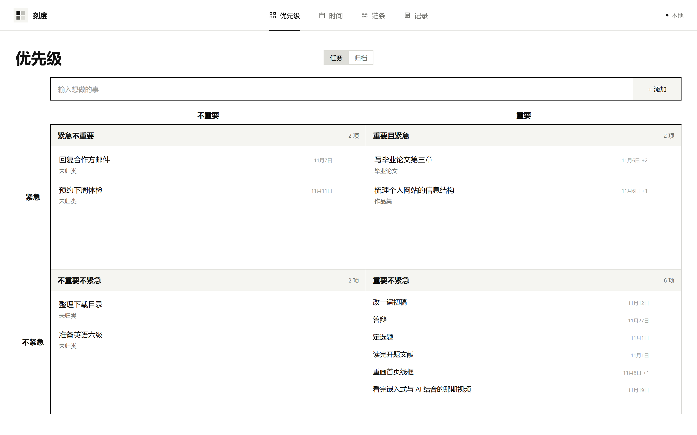
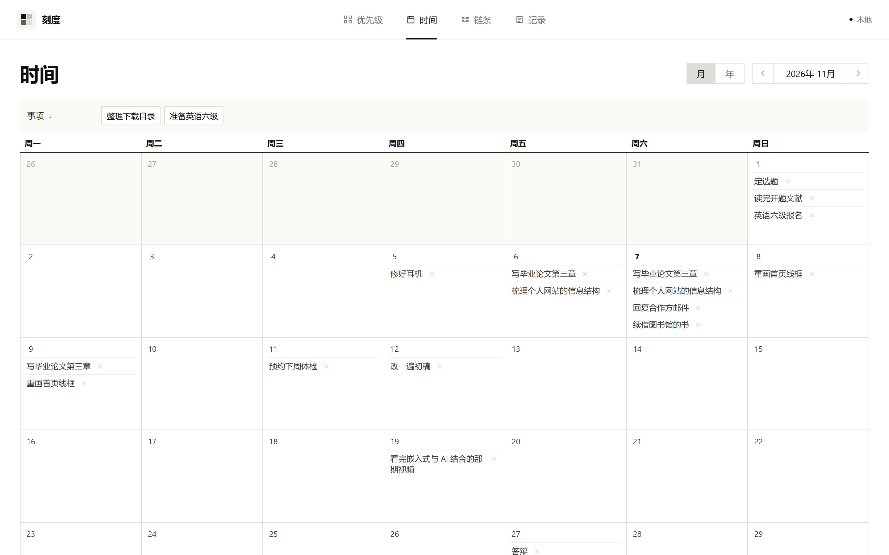
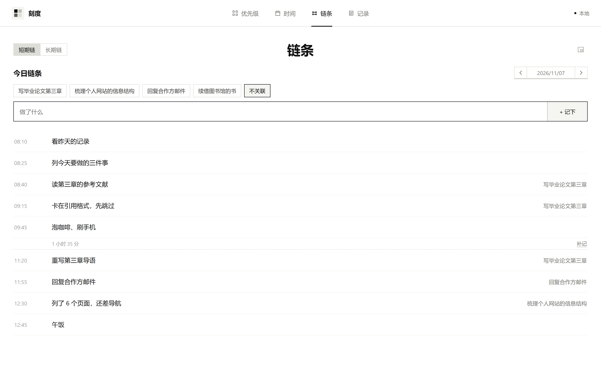
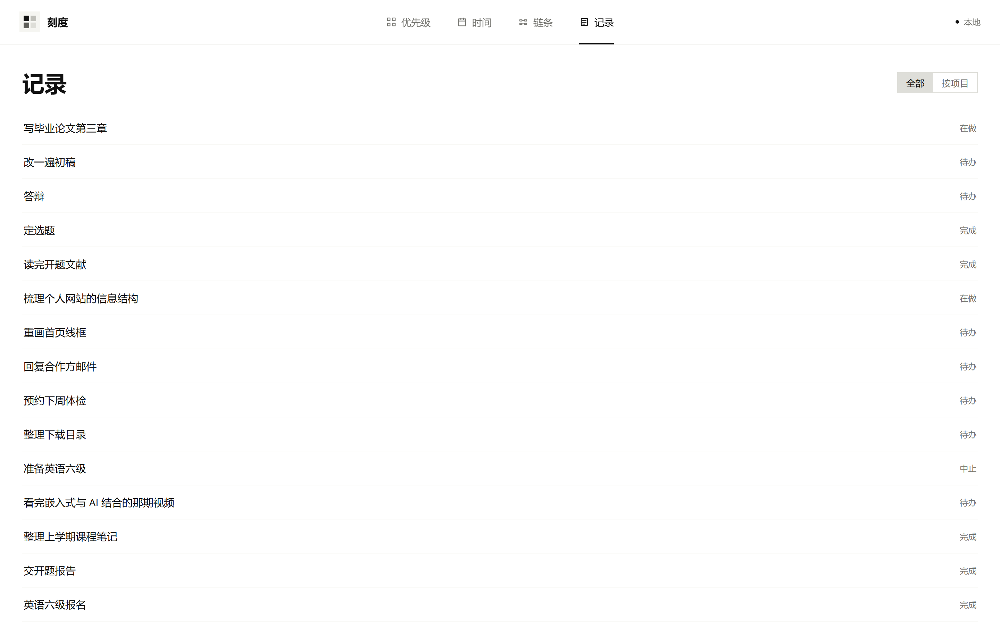
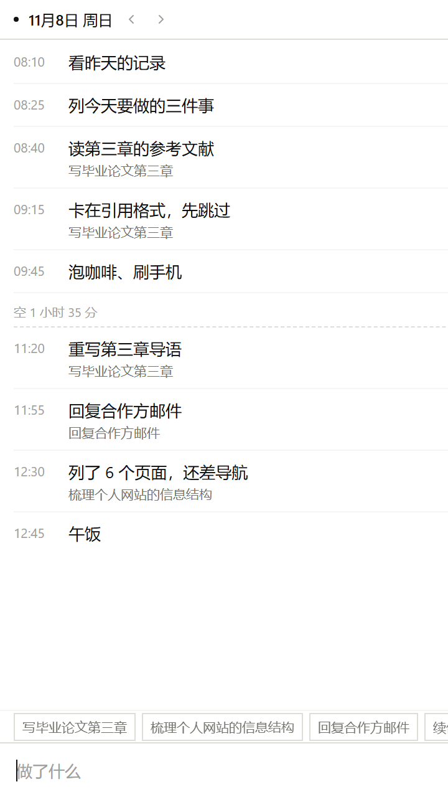

# 刻度 · Kedu

<p align="center"></p>

一个**把大脑外置**的微型记录软件。不参与知识库构建，也不是强提醒工具——只做及时的信息处理，把人脑的精力留给真正有意义的事。

单文件、零依赖、无框架：整个应用就是 `index.html` 一个文件，双击打开即用，数据保存在本地。

## 核心理念

**1. 大脑负责想事，不负责记事。**
“刷手机忘了刚才在干什么”，损失的从来不是那件事，而是重新进入状态的时间。刻度用**链条**把一天的流水按时间记下来，抬眼就能接上刚才的线头。

**2. 一件事被记下来，只处理三次。**
优先级矩阵定它要不要做 → 日历定它什么时候做 → 记录定它做得怎么样。刻度刻意**不做**知识库、标签系统、多层文件夹——信息在这里流动，不在这里囤积。

**3. 有始有终。**
每个任务只有三个记录字段：**进展 / 难点 / 收获**。任务中止时必须留下收获——放弃了什么、明白了什么。半途而废不可怕，白途而废才可怕。

**4. 数据归你。**
无账号、无网络、无云端。浏览器版是一个 HTML 文件 + localStorage；桌面版是离线的 Electron 程序。文件在你手里，数据在你机器里。

## 快速开始

**浏览器版**（推荐 Chrome / Edge 116+）：下载 [`index.html`](index.html)，双击打开即用。

**Windows 桌面版**：见 [`app/`](app/) 目录，离线安装包内含全部功能，任务数据可从浏览器版自动迁移。

## 四个页面

### 优先级 · 唯一的数据入口

<p align="center"></p>

新任务只问一句话：输入、回车即建，默认落在「重要不紧急」，再拖到该去的象限。没有优先级下拉、没有标签、没有文件夹——四象限（紧急 × 重要）就是全部。

- 任务在**待办 → 在做 → 完成 → 中止**四个状态间循环，点一下状态就切换。
- 对一件事的判断变了，把卡片拖进另一个象限就行，软件不拦着。
- 做不完的任务可以**归档**：从矩阵里消失、不再干扰排期，但日历、链条、记录里仍然保留。「归档」页按月 / 年日历存放归档任务，随时恢复。

### 时间 · 把要做的日子定下来

<p align="center"></p>

月视图和年视图一键切换：月视图管当月安排，年视图每月最多列 3 条，看的是全年密度和空档。

- 没排期的任务聚在**事项池**里，拖到任意日期格子上即完成排期，拖回事项池即取消。
- 一个任务可以排到**多天**：把同一张卡片再拖到别的日期即可，多个日子共用一张卡片——「背高数」这种横跨整周的事，不必拆成七条。

### 链条 · 一天的事，一件接一件

<p align="center"></p>

输入框写一句「现在在干什么」，回车即成一条流水，自动盖上当前时间的章。这是四种记录里用得最勤的一种。

- 漏记了？任意两条流水之间有**补记**入口，点一下就把那个空档的时间填进输入框。
- 每条流水可以贴一张**任务标签**（已排期的任务）：这一天和哪个任务有关，一眼可辨。
- **长期链**标签页管理多步任务：链内节点拖动排序，完成进度自动计数；没入链的任务待在「未入链」池里，拖进去即挂上；删链不删任务。

### 记录 · 有始有终

<p align="center"></p>

每个任务三个字段：**进展**（做到哪了）、**难点**（卡在哪）、**收获**（明白了什么）。

- 把任务标成「中止」时，如果它还没有收获，收获输入框会自动弹出等你写——放弃了什么、明白了什么。半途而废不可怕，白途而废才可怕。
- **全部 / 按项目**两种看法：全部按时间混排流水账；按项目则按长期链分组，一个任务的三个字段凑在一起看。

## 小窗：今日链路常驻屏幕角落

链条页右上角的小窗图标（或 `Alt+L`）会把**今日链路**打开成一个置顶小窗：屏幕面积的 1/16、9:16 竖版，写别的时始终挂在角落，随手记一条。

<p align="center"></p>

- 标题栏的**图钉**是固定开关：亮着 = 小窗永远浮在最上层；灭掉 = 取消固定，**小窗留在原地不关闭**，只是能被别的窗口盖住。
- 收回小窗、回到主窗口是另外两个入口：点 `↗`，或再按一次 `Alt+L`。
- 小窗和主窗口是同一份数据，哪里记的都一样；小窗大小可以拖，会记住。
- 桌面版（Electron）提供原生置顶窗口；浏览器版使用 Chrome / Edge 的画中画能力（116+），其他浏览器退化成普通弹出窗。

## 已知限制

记录存在 **localStorage 站点数据**里，不是看得见的文件，也还没有导出/备份功能。两个版本丢数据的方式不一样：

| 版本 | 数据在哪 | 什么会丢 |
|---|---|---|
| 浏览器版 `index.html` | 浏览器的站点数据，键名 `kedu.v2` | 清除浏览数据（勾选 Cookie / 网站数据）、换浏览器打开、无痕窗口关闭 |
| 桌面版 `kedu.exe` | `%APPDATA%\kedu-desktop` | 删除该目录 |

- **清空浏览器数据只影响浏览器版**，桌面版读的是自己的数据目录，不受影响。
- 反过来，删掉桌面版的程序目录也不会丢数据，重新解压一份 `kedu.exe` 打开，记录还在。
- 浏览器版以 `file://` 打开，同一浏览器里所有本地 HTML 共用一块存储：移动、改名、重启都不影响，换浏览器才是另一份数据。
- 全量重渲染，任务量上千后交互可能有可感知延迟（实测 1000 条任务时单次渲染约 13ms，正常使用无感）。

## 开发

```bash
node tools/make-demo.mjs
```

会按 `index.html` 生成一份带模拟数据的 `kedu-demo.html`，方便体验和截图；数据带指纹，内容没变时刷新不会覆盖你在演示里的改动。

桌面版开发与打包见 [`app/package.json`](app/package.json)。`app/index.html` 是构建产物，由主目录的 `index.html` 复制而来，不要直接编辑。

## 技术细节

- 纯 ES5 + 手写模板字符串渲染，无构建步骤。
- 事件全部委托在 `document` 上，动作用 `ACT['xxx']` 注册。
- 拖拽按落点（`data-drop`）分派：日历格、事项池、象限、链节点、未入链池。
- 一份 `index.html` 同时服务三种宿主：浏览器、画中画小窗、Electron（`IS_MINI` / `ELEC` 双标志区分）。

## License

[MIT](LICENSE)
